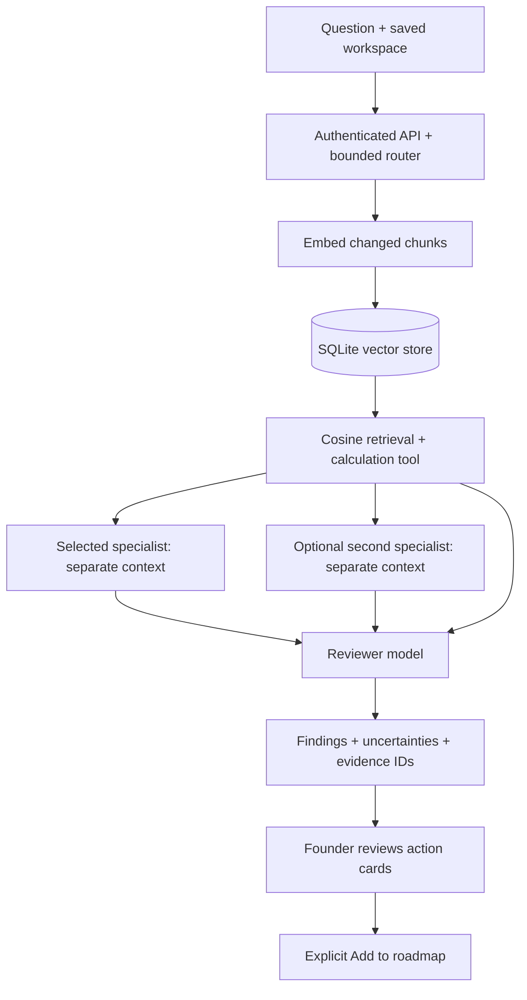

# BuildMyIdea

An electronics startup planning workspace with visual decision tools, persistent
startup data, and a bounded multi-agent LLM workflow backed by vector retrieval.

## Run locally

Use **Node.js 22.13 or newer** (tested on 22.22.3). The backend uses Node's built-in
SQLite module, which emits an experimental-feature warning on Node 22.

```bash
npm install
npm run dev
```

This starts the frontend at http://localhost:5173. Visual planning, manual editing,
calculations and the local compliance evidence workbench work without an LLM.
Agent runs require the server and models below. No fake AI result is substituted if
the model service is unavailable.

### Enable multi-agent inference

1. Install [Ollama](https://ollama.com/download) and start its local service.
2. Download the configured models (these downloads require disk space and RAM):

```bash
ollama pull qwen2.5:3b
ollama pull llama3.2:3b
ollama pull nomic-embed-text
```

3. Optionally copy `server/.env.example` to `server/.env` and configure models.
   Defaults work without this file. Do not put private provider keys in Vite variables.
4. Start both processes:

```bash
npm run dev:full
```

Alternatively run `npm run dev` and `npm run server` in separate terminals.
The API binds to `127.0.0.1:8787`; Vite proxies `/api` requests to it.
Sign in with Firebase, open a startup, then use **Startup Copilot → Check models**.
The status identifies missing generation or embedding models. To pull configured
models using the optional helper, run `npm run setup:models` after installing Ollama.
On Windows, `powershell -File scripts/setup-ollama.ps1` optionally downloads a
checksum-verified portable runtime into `server/.runtime`; the model helper can
start that runtime with model files under `server/data/models` and logs in
`server/data/ollama.log`. Downloads are large and are never triggered by a question.

During this implementation, the official runtime download failed with connection
resets. Live model inference therefore remains unverified on this machine; install
Ollama and pull the models before expecting Copilot to generate answers.

## How the agents collaborate

These are separate inference invocations with separate system prompts and structured
outputs, coordinated by `server/orchestrator.ts`. They are not separate OS processes
and do not all run on every request. Specialists have independent contexts; the
reviewer receives their outputs and the same evidence as a subsequent handoff.



| Agent | Responsibility | Default model / setting |
| --- | --- | --- |
| Planning | Cross-module decisions and missing evidence | `qwen2.5:3b` / `MODEL_PLANNER` |
| Product | Specifications, BOM, manufacturing and sourcing tradeoffs | `qwen2.5:3b` / `MODEL_PRODUCT` |
| Finance | Interpret the deterministic financial calculations | `qwen2.5:3b` / `MODEL_FINANCE` |
| Compliance | Review relevant government summaries and applicability gaps | `qwen2.5:3b` / `MODEL_COMPLIANCE` |
| Team | Hiring sequence, responsibilities and payroll | `qwen2.5:3b` / `MODEL_TEAM` |
| Scaling | Capacity, capital and evidence needed for stage gates | `qwen2.5:3b` / `MODEL_SCALING` |
| Reviewer | Examine specialist findings, conflicts and evidence gaps | `llama3.2:3b` / `MODEL_REVIEWER` |

The default uses **two generation models** and an embedding model. Specialist agents
reuse the smaller model's weights while retaining separate instructions and contexts.
Assign any installed compatible Ollama model to each setting for different weights.
To reduce RAM further, the reviewer can use the same model as the specialists; this
retains multiple agent contexts but removes model diversity.

Automatic routing activates at most two specialists. For example, “team payroll
budget” activates Finance and Team, then Reviewer. A selected module agent uses that
one specialist plus Reviewer, with Compliance added when the question includes legal
topics. Calls execute sequentially to limit GPU/RAM contention.
The coordinator also runs financial and capacity calculation tools with ordinary
code, so arithmetic is provided as explicit evidence rather than delegated to an LLM.

This is a fixed, bounded orchestration system, not an open-ended autonomous agent
loop. Agents cannot execute shell commands, browse arbitrarily, approve compliance,
or silently modify startup modules. The router itself is deterministic and costs no
model call. Independent review can still share errors and does not guarantee accuracy.

## Vector database and RAG

The server implements a persistent **SQLite-backed vector store** in
`server/vectorStore.ts`. It stores actual embedding arrays from Ollama, document text,
SHA-256 content hashes, source identifiers, scope and embedding-model name.

**Disk location:** `server/data/knowledge.sqlite` (plus SQLite WAL/SHM files).
Override the folder with `VECTOR_DATA_DIR`. This folder is ignored by Git and is not
served by Vite. It contains private business data; protect it and any backups.

The pipeline:

1. Select business fields from the authenticated user's submitted saved workspace.
   Conversation messages and previous agent reports are excluded from factual indexing.
2. Split fields into chunks of up to 1,400 characters with 200-character overlap.
3. Embed only changed chunks in batches of at most 12 using `EMBEDDING_MODEL`
   (default `nomic-embed-text`). An embedding-model change rebuilds that scope's index.
4. Store the successful snapshot transactionally and remove outdated chunks.
5. Embed a focused question for each selected specialist and calculate exact cosine
   similarity over the allowed scope.
6. Retrieve up to three startup chunks per specialist, or two when Compliance is
   selected, plus three government chunks for Compliance. Deduplicate the combined
   evidence and include a separate deterministic calculation record.
7. Supply this bounded evidence to specialist models and the reviewer.

Similarity scores express vector proximity, **not factual confidence**. This is exact
vector search over a small corpus, not an approximate-nearest-neighbor index or a
managed vector service. The per-startup index is limited to 256 chunks. For larger
workloads, replace the store adapter with pgvector/Qdrant or another indexed store.

Private scopes are derived from the verified Firebase UID and startup ID. Shared
government records have a separate scope. Search never scans another user's private
scope. Inputs come from the authenticated browser snapshot, not an Admin Firestore
read; user-entered planning facts remain unverified assumptions.

Copilot includes **Clear this startup's vector index**, which removes that private
scope. The next run rebuilds it. Deleting a Firestore startup does not automatically
delete this separate index or recursively delete Firestore subcollections: clear the
index first and use an authenticated server cleanup workflow for production retention.

The earlier `src/services/ragService.ts` lexical Firestore prototype remains in the
repository for legacy callers. It is not the vector backend used by the new agent UI.

## Compliance sources and two review modes

Bundled, curated summaries are stored in `src/data/complianceKnowledge.ts`. Their
recorded snapshot date is **2026-09-09**. They include links to:

- [BIS Scheme II](https://www.bis.gov.in/product-certification/products-under-compulsory-certification/scheme-ii-registration-scheme/?lang=en)
- [DoT/WPC ETA](https://www.eservices.dot.gov.in/equipment-type-approval-eta)
- [CPCB E-Waste FAQ](https://cpcb.gov.in/uploads/Projects/E-Waste/FAQ_ewaste_23012024.pdf)
- [Legal Metrology rules](https://consumeraffairs.nic.in/sites/default/files/file-uploads/latestnews/LM_PCR_All_Amendements.pdf)
- [MCA SPICe+ FAQ](https://www.mca.gov.in/content/dam/mca/pdf/SPICEplus-and-linked-filings-FAQs-V3-20230122.pdf)
- [CBIC GST FAQ](https://cbic-gst.gov.in/faq.html)
- [DPIIT recognition](https://www.startupindia.gov.in/content/sih/en/startupgov/startup_recognition_page.html)

Refresh official source snapshots explicitly with `npm run ingest:government`.
The fetcher uses a fixed HTTPS government-host allowlist, checks redirects, limits
size/time, and extracts HTML or PDF text. It does not browse arbitrary user URLs.

**Fetched storage:** `server/data/government/<source-id>.html` or `.pdf`
contains the downloaded document; `<source-id>.json` contains extracted text,
source URL and fetch timestamp. `ingestion-report.json` records individual success
and failure results. These generated files are ignored by Git.

The refresh on **2026-09-09** stored five sources: BIS, DoT/WPC, CPCB, CBIC and DPIIT.
Legal Metrology failed to fetch and MCA returned HTTP 403. Failed refreshes retain
previous snapshots; where none exists, RAG uses the clearly marked bundled summary.
The command exits nonzero when any source fails. Copilot's model check also displays
source-refresh counts.

Retrieved snapshots are **fetched but not legally reviewed**. Successful download
does not establish completeness, current applicability or absence of amendments.
Snapshots older than 30 days are flagged; refresh is operator-triggered, not scheduled.
Changed source chunks are embedded on the next compliance run. Review original
sources and amendments before operational use.
Indexing is capped at the first 100 chunks per source; full extracted text remains
on disk. Retrieval is selective, not an exhaustive legal review of each document.

**Local evidence workbench:** “Build with compliance RAG” uses confirmed market,
wireless, role and packaging facts to filter summary candidates, show questions and
propose review tasks. It is deterministic; it does not invoke an LLM. Select tasks,
assign owners, add review references, then Save. Existing checklist edits are preserved.

**Compliance agent:** expand “Ask the compliance agent” on that page, or choose
Compliance in Copilot. This runs semantic retrieval, the compliance LLM and reviewer.
It returns an inspectable report and roadmap proposals. It does not determine legal
applicability or automatically mark checklist items complete.

Government coverage is limited to India and the bundled topics. Questions about
other jurisdictions or absent sources require additional evidence. Neither agents
nor retrieval eliminate hallucinations; unknown citation IDs and malformed output
are rejected, but a valid ID alone cannot prove that a claim follows from its source.

## Visual planning and Copilot interaction

- **Team:** hiring-stage payroll bars, movable role cards, assigned reporting links,
  cycle prevention, hiring status and optional explicit synchronization of the full
  planned payroll to Finance. This budget includes all hiring stages.
- **Scaling:** connected stage selector, capacity target chart, capacity/capital gaps,
  measurable exit criteria and recorded evidence. A Ready gate requires earlier Ready
  gates; editing upstream assumptions resets affected ready gates for review.
- **Product:** specification blocks. **BOM:** largest component-cost bars.
- **Manufacturing:** capacity formula flow. **Finance:** price/cost simulator.
- **Roadmap:** saved-status board and editable milestones. **Risks:** severity matrix.
- **Supply chain / Distribution:** connected stage flows and expandable editing.
- **Identity:** customer → problem → value → business model flow.
- **Startup Journey:** nine clickable stages from opportunity validation through
  responsible scaling. Each stage calculates workspace readiness, shows unmet
  dependencies, visualizes input → work → output, identifies the next missing item,
  and links directly to the connected modules.
- **Overview:** a compact stage strip plus four decision metrics; detailed opportunity
  assumptions stay collapsed until edited.
- **Identity:** a selectable evidence → logic → direction map explains which original
  inputs should ground the customer, problem, solution, value, mission and vision.
- **Product / BOM / Manufacturing / Finance:** graphs and flows appear before compact
  editors. Detailed specifications, component rows, operating assumptions and financial
  inputs expand only when needed.
- **Agent placement:** general multi-agent work lives in Copilot; Compliance keeps one
  collapsed specialist review because source-grounded legal review is relevant there.

New real workspaces start empty except for values explicitly supplied during creation.
They no longer clone the laptop demo. On load, an exact legacy laptop-template signature
inside a non-laptop venture is removed from the in-memory workspace so it cannot enter
RAG or agent requests; genuine laptop ventures and customized data are not matched.
Every agent run also receives a non-optional `venture-scope` evidence record containing
the original category and idea. Product-specific BIS and WPC evidence is filtered out
unless the saved venture scope contains matching product or wireless terms.

Copilot displays actual streamed progress events, specialist/model identities,
reviewer concerns, retrieved evidence and action cards. There is **no artificial
generation delay**. Cancellation propagates to the model requests. Failed runs stay
failed; they do not produce a simulated success. Reports appear before background
Firestore saving, and a failed report save can be retried. “Add to roadmap” is an
explicit write; other agent suggestions do not automatically change module data.
Follow-up questions include a bounded excerpt of the currently displayed report as
conversation context, explicitly not factual evidence or vector-index knowledge.

## Firebase and storage

The Firebase project remains `venturepilot-cf134`. Configure `.env.local` from
`.env.example`. Enable email/password Authentication and Cloud Firestore. Web config
identifies the project and is not a private server credential.

```bash
firebase use venturepilot-cf134
firebase deploy --only firestore:rules,firestore:indexes
```

Deployment is a separate operation; repository changes do not deploy rules.

| Data | Location |
| --- | --- |
| Startup fields and old conversation history | `users/{uid}/startups/{startupId}` |
| Saved new agent reports | `users/{uid}/startups/{startupId}/agentRuns/{runId}` |
| Legacy lexical RAG documents | `users/{uid}/startups/{startupId}/ragDocuments/{sectionId}` |
| Active vector index | `server/data/knowledge.sqlite` |
| Bundled government summaries | `src/data/complianceKnowledge.ts` |
| Downloaded government documents, extracted text and fetch report | `server/data/government/` |
| Server model configuration | `server/.env` (ignored by Git) |

The API validates Firebase ID token signature, issuer, audience and expiry using
Google's public keys, and compares the submitted owner with the verified UID. It does
not require a Firebase Admin private key. Token verification requires access to Google's
key service. Reports use the existing per-user Firestore rules.

Resource limits: one local run at a time, at most six starts per user/minute,
350 KB request bodies, 256 startup chunks, bounded model output, 120-second model-call
timeout and six-minute total request deadline. Model contexts are not persisted.
Malformed model JSON and citations to unsupplied evidence IDs fail the run.

Production requires a hosted Node/Ollama backend (Firebase static Hosting alone cannot
run it), a same-origin `/api` reverse proxy, protected persistent storage, appropriate
retention, and deployment-level monitoring/auth abuse controls. The local server binds
to loopback intentionally. `VITE_AI_API_URL` belongs to the legacy gateway and does not
configure the new `/api/agents/run` endpoint.

## Commands and verification

```bash
npm run dev           # frontend only
npm run dev:full      # frontend + agent API
npm run server        # agent API only
npm run build         # frontend typecheck + bundle
npm run check:server  # backend typecheck
npm run lint
npm test              # frontend, calculations and interaction tests
npm run test:server   # SQLite, routing, isolation and model-adapter tests
npm run ingest:government # refresh allowlisted official source snapshots
npm run setup:models # pull configured models; requires installed/portable Ollama
npm run preview      # static production preview; requires separate API proxy for agents
```

Server tests use temporary databases and a controlled model stub, not downloaded LLM
weights. They exercise persistence, scope isolation, incremental replacement, error
handling, independent agent contexts and reviewer handoffs. Real model inference and
Firebase-authenticated end-to-end testing require installed models and a signed-in
workspace. Model output quality requires separate evaluation with representative cases.

Implementation references: [Ollama chat API](https://docs.ollama.com/api/chat),
[embedding API](https://docs.ollama.com/api/embed), [Node SQLite](https://nodejs.org/api/sqlite.html),
and [jose token verification](https://github.com/panva/jose).

## Demo data

Explore demo creates a private copy of the NovaEdge planning dataset. Sample prices,
risks, compliance entries, scores and operating assumptions are illustrative data,
not supplier quotes or verified feasibility findings. Legacy mock AI service methods
remain for compatibility; the new agent workspace uses the server pipeline above.
