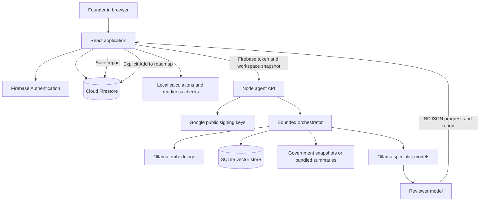

# BuildMyIdea / VenturePilot — Technical Analysis

Analysis date: **2026-10-08**

This document records the repository inspection performed before implementation work. It describes the inspected code, not a verified production deployment. The repository is named `VenturePilot`; the application and package identify themselves as **BuildMyIdea** and `build-my-idea`.

No application files were changed during the analysis. This document was subsequently created at the user's request. Existing changes to `.gitignore` and `package-lock.json`, and the untracked `.DS_Store`, were left untouched. No packages were installed, models downloaded, services deployed, or external data changed.

## Contents

1. [Project overview](#1-project-overview)
2. [Problem statement and solution](#2-problem-statement-and-solution)
3. [Architecture](#3-architecture)
4. [Project map](#4-project-map)
5. [Technology stack](#5-technology-stack)
6. [Complete application workflows](#6-complete-application-workflows)
7. [Frontend analysis](#7-frontend-analysis)
8. [Backend and API reference](#8-backend-and-api-reference)
9. [Database analysis](#9-database-analysis)
10. [AI and retrieval pipeline](#10-ai-and-retrieval-pipeline)
11. [Government ingestion and external services](#11-government-ingestion-and-external-services)
12. [Authentication and security](#12-authentication-and-security)
13. [Calculations and planning rules](#13-calculations-and-planning-rules)
14. [Implementation status](#14-implementation-status)
15. [Problems discovered](#15-problems-discovered)
16. [Documentation versus code](#16-documentation-versus-code)
17. [Configuration and local execution](#17-configuration-and-local-execution)
18. [Testing and verification](#18-testing-and-verification)
19. [Deployment](#19-deployment)
20. [Files I must understand](#20-files-i-must-understand)
21. [Interview explanation](#21-interview-explanation)
22. [Recommended changes](#22-recommended-changes)

## 1. Project overview

BuildMyIdea is an electronics startup planning workspace. It helps founders connect an original idea to:

- Customer problems, startup identity, and product requirements.
- Bill of materials, manufacturing, supply chain, and distribution.
- Compliance review, financial assumptions, hiring, and risk ownership.
- Launch milestones, scaling gates, and a printable startup blueprint.
- Optional AI-assisted decisions using workspace evidence and government references.

It organizes and evaluates **planning assumptions**. It does not establish actual customer demand, obtain supplier quotes, perform engineering simulation, execute production, or determine legal compliance.

Creating a startup does not generate a complete business plan. New workspaces contain the supplied inputs and mostly empty planning modules. A separate, explicitly labelled demo contains illustrative laptop-business data.

## 2. Problem statement and solution

The problem is fragmentation: specifications, component costs, manufacturing capacity, payroll, compliance, and launch timing affect one another but are often maintained separately.

The application addresses this with three mechanisms:

1. **Shared structured workspace:** modules read and update a single startup document.
2. **Deterministic calculations and checks:** ordinary TypeScript calculates costs, margins, capacity, reporting relationships, and readiness.
3. **Optional bounded AI review:** selected specialists inspect retrieved evidence; a reviewer consolidates their findings; the founder explicitly accepts actions.

The application is a planning and decision-support tool, rather than an autonomous startup execution system.

## 3. Architecture



Two boundaries are essential:

- **Ordinary CRUD goes directly from React to Firebase.** The Node service does not implement startup CRUD endpoints.
- **The AI service receives a browser-submitted snapshot.** It verifies the Firebase token and compares the submitted owner with the verified UID. It does not retrieve the workspace using an Admin Firestore client.

The backend uses Node's HTTP server directly. There is no Express, Next.js, Firebase Functions, or agent framework.

## 4. Project map

```text
VenturePilot/
├── src/
│   ├── main.tsx / App.tsx       Browser entry and lazy routes
│   ├── pages/                  Auth, dashboard, planning modules, Copilot
│   ├── components/             Workbenches, visualizations, shared controls
│   │   ├── layout/             Application navigation and outlet
│   │   └── ui/                 Buttons, fields, metrics, loading skeletons
│   ├── context/                Auth and toast state
│   ├── hooks/                  Startup loading and saving
│   ├── services/               Firebase, agent client, local/legacy AI logic
│   ├── types/                  Startup and agent contracts
│   ├── data/                   Demo, blank drafts, compliance summaries
│   └── utils/                  Calculations, journey checks, planning rules
├── server/
│   ├── index.ts                Authenticated local HTTP API
│   ├── orchestrator.ts         Routing, indexing, retrieval, model handoffs
│   ├── models.ts / health.ts    Ollama adapters and availability checks
│   ├── vectorStore.ts          SQLite persistence and exact cosine search
│   ├── government.ts           Source snapshot loading and fallback
│   ├── ingestGovernment.ts     Allowlisted HTML/PDF ingestion
│   ├── ingest.ts               Ingestion CLI entry
│   ├── setupModels.ts          Explicit model installation helper
│   ├── tests.mts               Backend tests
│   └── data/                   Ignored local SQLite runtime files
├── scripts/                    Development and Windows Ollama helpers
├── firebase.json               Static hosting and Firestore deployment files
├── firestore.rules             Database authorization
├── firestore.indexes.json      No custom composite indexes
├── vite.config.ts              Build and development proxy
├── package.json / lockfile      Commands and dependency resolution
└── README.md                   Setup and architecture documentation
```

### Important directory and file roles

| Location | Purpose and dependencies | Status |
|---|---|---|
| `src/main.tsx` | Mounts React, browser router, toast provider | Active |
| `src/App.tsx` | Public/authenticated routes, lazy page imports | Active |
| `src/pages/` | User-facing modules; all page files are routed | Active |
| `components/AgentWorkbench.tsx` | Runs, cancellation, progress, evidence, reports, roadmap actions | Active in Copilot and Compliance |
| `components/ComplianceWorkbench.tsx` | Deterministic compliance evidence/task review | Active |
| `components/StartupJourney.tsx` | Nine-stage readiness visualization | Active |
| `components/ModuleVisual.tsx` | BOM and manufacturing charts | Active |
| `components/FlowEditor.tsx` | Ordered supply/distribution stage editing | Active |
| `components/VisualPlan.tsx` | Exports several older visuals and `ProcessFlow` | `ProcessFlow` active; other exports appear unused |
| `components/DecisionWorkbench.tsx` | Five calculated decision checks | No active production caller found |
| `hooks/useStartup.ts` | Reads route/user, loads startup, saves updates | Shared by startup pages |
| `services/firestoreService.ts` | Startup CRUD and demo duplication | Active |
| `services/agentClient.ts` | Token headers, NDJSON parsing, report persistence | Active |
| `services/decisionWorkflow.ts` | Local compliance retrieval and proposal merging | Active compliance functions |
| `services/aiService.ts` | Older mock AI implementation | No active page caller found |
| `services/agentService.ts` | Older planning/compliance wrappers | Legacy chain |
| `services/ragService.ts` | Lexical ranking and Firestore RAG mirroring | Legacy; ranking tests present |
| `services/llmGateway.ts` | Optional external grounded-model gateway | Legacy |
| `src/types/` | Shared TypeScript data contracts | Frontend and backend |
| `src/data/` | Demo, draft creation, legacy cleanup, seven source summaries | Active |
| `src/utils/` | Finance, capacity, reporting, gate and journey logic | Active; calculations shared with backend |
| `server/` | AI API, storage, adapters, ingestion and setup | Active backend |
| `scripts/` | Combined development processes; optional runtime setup | Explicit operator commands |

Generated `dist/`, installed `node_modules/`, binary files, and TypeScript build metadata were excluded from source analysis. Relevant lockfile metadata and runtime file presence were inspected. Private SQLite document contents were not inspected.

There is no Dockerfile, container composition, CI workflow, production backend manifest, migration framework, or scheduled ingestion configuration.

## 5. Technology stack

Versions below are resolved versions in the inspected lockfile where specified.

| Category | Technology | Evidence |
|---|---|---|
| Frontend | React 18.3.1, TypeScript | `src/main.tsx`, TSX pages |
| Routing | React Router 7.18.2 | `BrowserRouter`, nested routes/outlets |
| Styling | Tailwind CSS 3, PostCSS, Autoprefixer | CSS and configuration files |
| UI helpers | Lucide React, `clsx` | Icons and layout/control classes |
| State | React state, effects, context, refs | Page drafts, auth, agent lifecycle |
| Backend | Node built-in HTTP | `createServer()` in `server/index.ts` |
| TS execution | `tsx` 4.23.13 | Backend npm scripts |
| Primary database | Cloud Firestore, Firebase SDK 11.10.0 | Firebase service imports |
| Vector storage | Node built-in SQLite | `DatabaseSync` |
| Authentication | Firebase email/password | `authService.ts` |
| Token validation | `jose` 6.2.12 | `jwtVerify`, remote JWKS |
| Runtime schemas | Zod 3.25.76 | Requests, model outputs, streams, source records |
| AI | Ollama HTTP API | `/api/chat`, `/api/embed` |
| Specialist model | Default `qwen2.5:3b` | `modelFor()` |
| Reviewer model | Default `llama3.2:3b` | `modelFor()` |
| Embedding model | Default `nomic-embed-text` | `embeddingModel()` |
| HTML extraction | Cheerio 1.2.0 | Government ingestion |
| PDF extraction | `pdf-parse` 2.4.5 | `PDFParse` |
| Build | Vite 6.4.3, TypeScript 5.6.3 | Scripts/configuration |
| Frontend tests | Vitest 2.1.9, Testing Library, jsdom | Nine test files |
| Backend tests | Node test runner, `node:assert` | `server/tests.mts` |
| Deployment | Firebase static Hosting | `firebase.json` |
| Package manager | npm | Scripts and lockfile |

`react-hook-form` and `@hookform/resolvers` are declared but have no source imports. Forms use local React state and native controls. No Redux, Zustand, charting library, LangChain, managed vector service, training, or fine-tuning code was found.

## 6. Complete application workflows

### Registration and login

`AuthPages.tsx` → `authService.ts` → Firebase Authentication / Firestore → `AuthContext.tsx`.

Registration collects name, email, password, and confirmation. After checking agreement and native password length requirements, `register()`:

1. Calls `createUserWithEmailAndPassword()`.
2. Updates the Firebase display name.
3. Writes `users/{uid}` with profile fields and an ISO creation date.
4. Returns the user so the UI can optionally duplicate the demo and navigate.

Login uses `signInWithEmailAndPassword()`. `onAuthStateChanged()` drives shared user/loading state. `ProtectedRoute` waits for initialization and redirects unauthenticated visitors to login, recording the requested path.

`friendlyAuthError()` translates common Firebase failures. Account creation, profile update, profile persistence, and demo duplication are separate operations; partial registration is possible.

### Create a startup

`CreateStartupPage.tsx` → `createStartupDraft()` → `createStartup()`.

1. Collect founder details and budget.
2. Collect idea, category, customer, market, price, and launch duration.
3. Check required fields and positive finite integer price/duration.
4. Construct a mostly empty workspace using submitted inputs.
5. Write with `addDoc()` under `users/{uid}/startups`.
6. Navigate to Overview.

Defaults include India, budget ₹1,000,000, `Idea validation`, and stored progress 10. There is no LLM call. New product specs, BOM, compliance, team, risks, roadmap, and scaling arrays are empty.

### Load and edit a module

Page → `StartupPageState` → `useStartup()` → `firestoreService.ts`.

1. Resolve route startup ID and authenticated user.
2. Fetch the user-scoped document.
3. Apply `sanitizeLegacyLaptopTemplate()` in memory.
4. Initialize a page-local draft.
5. Recalculate visuals as the draft changes.
6. Explicit Save calls `updateDoc()` with a partial update and timestamps.
7. Merge the update into local hook state after persistence succeeds.

Most saves replace an entire nested module map or array. There are no realtime subscriptions, shared query cache, optimistic concurrency checks, or unsaved-navigation guards.

### Demo workspace

`duplicateDemo()` writes a private copy of NovaEdge laptop-planning data. The demo requires authentication and is real persisted user data, not an anonymous preview. Its prices, assumptions, scores, and risks are illustrative.

### Local compliance review

`ComplianceWorkbench.tsx` → `decisionWorkflow.ts`.

1. Confirm market, wireless hardware, business role, and packaged-goods facts.
2. `runComplianceReview()` filters/ranks bundled summaries and identifies missing facts.
3. Display source candidates, applicability questions, and task proposals.
4. User selects actions and optional owner/reference.
5. `proposalToItem()` creates entries; `mergeProposals()` preserves existing entries and deduplicates source URLs.
6. Parent page Save persists the checklist.

This path performs no LLM call, embedding, vector search, live source request, or Node API request. Confirmed facts remain component state rather than a persisted structured review record.

### Copilot run

`AgentWorkbench.tsx` → `agentClient.ts` → Node API → orchestrator → SQLite/Ollama.

1. Submit question and optional specialist choice.
2. Obtain Firebase ID token.
3. Send workspace snapshot and optional bounded previous-report context.
4. Verify token, ownership claim, request shape, and resource limits.
5. Check selected models are installed.
6. Embed/index changed workspace chunks.
7. Retrieve scoped evidence and calculate finance/capacity facts.
8. Run one or two specialists sequentially.
9. Run reviewer with original evidence and condensed specialist findings.
10. Stream workflow progress and final result.
11. Display result immediately; persist the report separately to Firestore.
12. Offer retry if persistence fails.

Cancellation aborts the browser request and propagates toward model calls. Failure does not substitute a simulated success.

### Accept an agent action

Reviewer cards provide a module link and **Add to roadmap**. The latter appends a milestone with action text, report ID, and evidence IDs. IDs follow `agent-${runId}-${actionIndex}` for duplicate detection in current workspace state.

The action does not automatically modify its suggested target module. The user must edit product, finance, compliance, or other module data separately.

### Blueprint

`BlueprintPage.tsx` renders 22 sections from saved data and deterministic calculations. Printing uses `window.print()`. No PDF-generation service, versioned blueprint document, or AI generation is involved.

The current Save button only writes `progress: 100` and announces success immediately. It does not persist a blueprint artifact.

## 7. Frontend analysis

Entry: `index.html` → `src/main.tsx` → `src/App.tsx`.

Routes are mostly lazy-loaded. `Suspense` provides route loading. Authenticated screens render inside `AppShell`, which supplies sidebar/mobile navigation, profile menu, and an outlet.

Startup routes below share `/startup/:startupId`.

| Page / route | Purpose and actions | Persisted data |
|---|---|---|
| Landing `/` | Marketing, registration, demo link | None |
| Login `/login` | Email/password sign-in | Firebase Auth |
| Register `/register` | Signup and optional demo | Auth, profile, optional startup |
| Dashboard `/dashboard` | List/open/delete startups; demo creation when empty | Startup collection |
| Create `/startup/new` | Two-step founder/idea form | New startup |
| Overview, base path | Readiness, metrics, opportunity assumptions | `analysis` |
| Journey `/visual-plan` | Nine stages, dependencies, checks, module links | Read-only |
| Identity `/identity` | Evidence/logic/direction nodes | `identity` |
| Product `/product` | MVP, requirements, differentiation, specs | `product` |
| BOM `/bom` | Component CRUD and cost visualization | `bom` |
| Manufacturing `/manufacturing` | Strategy, capacity, quality, capital | `manufacturing` |
| Supply `/supply-chain` | Ordered process-stage CRUD | `supplyChain` |
| Distribution `/distribution` | Model and process stages | `distribution` |
| Compliance `/compliance` | Local proposals, checklist, optional AI review | `compliance`, separate reports |
| Finance `/finance` | Cost/margin/monthly outcomes and assumptions | `financials`, `expectedSellingPrice` |
| Team `/team` | Hiring stages, manager links, salary, status | `team`; optional payroll update |
| Risks `/risks` | Probability × impact matrix and register | `risks` |
| Scaling `/scaling` | Capacity/budget targets, criteria, evidence, gates | `scaling` |
| Roadmap `/roadmap` | Milestones, timing, deliverables, status | `roadmap` |
| Blueprint `/blueprint` | Consolidation and print | Save updates only `progress` |
| Copilot `/copilot` | Runs, evidence, reports, actions, index controls | API + Firestore reports/roadmap |
| Settings `/settings` | Read-only profile/configuration display | None |
| Not found `*` | Dashboard navigation | None |

### State, forms, visuals, and errors

- Local `useState` owns draft edits; auth/toast contexts handle shared concerns.
- Forms use controlled inputs and native browser constraints. No active React Hook Form usage was found.
- Charts use HTML/CSS and limited SVG, not a visualization framework.
- `StartupPageState` provides skeleton and startup-load error UI.
- `AgentWorkbench` handles progress, cancellation, errors, report-save retry, and report history.
- Compliance, Team, and Scaling catch save failures.
- Many other editors only reset loading in `finally`; they do not display rejected save errors.
- No route/render error boundary exists.

## 8. Backend and API reference

Implementation: [server/index.ts](server/index.ts).

### GET `/api/health`

**Purpose:** model availability and source-refresh summary.

**Input/authentication:** none; public endpoint.

**Processing:** `modelHealth()` fetches Ollama `/api/tags` with a four-second timeout and compares installed models with configured role/embedding names. `governmentStatus()` reads the local ingestion report.

**Database:** no mutation.

**Output:** JSON containing `available`, per-role `models`, `embedding`, `embeddingInstalled`, and `knowledge` refresh counts/date. If Ollama is unavailable, it still returns HTTP 200 with `available: false` and an error message.

HTTP 200 therefore does not establish model readiness.

### POST `/api/agents/run`

**Purpose:** bounded specialist/reviewer execution.

**Authentication:** `Authorization: Bearer <Firebase ID token>`.

**Input:**

```json
{
  "question": "Can our budget support hiring before launch?",
  "role": "finance",
  "previous": {
    "question": "Earlier question",
    "summary": "Earlier reviewed summary"
  },
  "startup": { "...": "workspace snapshot" }
}
```

`role` and `previous` are optional. The startup object above is schematic; the actual schema requires identity, BOM, finance, and manufacturing fields.

**Validation:**

- Trimmed question, 1–3,000 characters.
- Startup ID matching 1–128 word/hyphen characters.
- Bounded owner/name/category strings.
- Up to 500 BOM entries with finite nonnegative quantities and costs.
- Required finite nonnegative financial assumptions.
- Nonnegative production assumptions; utilization at most 100.
- Maximum request body 350,000 bytes.
- Other workspace fields largely pass through without complete runtime schemas.

**Processing:** JWT validation → concurrency/rate check → body/schema → owner comparison → model preflight → `runAgents()`.

**Dependencies:** jose, Zod, health adapter, orchestrator, SQLite, shared calculations, Ollama.

**Database:** reads/writes SQLite vectors. Firestore report persistence happens in the browser afterward.

**Response:** `application/x-ndjson`, one JSON event per line:

```json
{"type":"progress","data":{"stage":"Router","state":"complete","detail":"...","elapsedMs":25}}
{"type":"result","data":{"id":"...","question":"...","findings":[],"review":{},"evidence":[],"mode":"multi-agent","durationMs":12000}}
```

The result example illustrates the envelope; production findings/review must satisfy their schemas.

| Failure | Behavior |
|---|---|
| Invalid or missing token | 401 |
| Owner differs from token UID | 403 |
| Globally busy or user start limit reached | 429 |
| Invalid body/schema before streaming | 400 |
| Failure after stream starts | HTTP 200 with `type: "error"` event |
| Client disconnect | Abort signal propagates toward inference |

Resource limits are one run globally per process, six accepted starts/user/minute, six-minute total abort deadline, and two-minute Ollama embedding/chat request timeout. There is no queue or distributed limiter.

### DELETE `/api/knowledge/:startupId`

**Purpose:** delete the authenticated user's private vector scope.

**Authentication:** Firebase bearer token.

**Processing:** validate ID; reject with 409 if that user has an active run; derive scope from verified UID plus ID; call `store.remove()`.

**Output:** `{"deleted":true}`.

It does not delete the startup, reports, legacy RAG documents, or government vectors. It does not check whether the startup exists in Firestore. Invalid ID returns 400; unknown API routes return 404.

### Jobs and operational processes

There are no background workers or scheduled jobs. Source ingestion and model installation run only through explicit CLI commands. `scripts/dev.mjs` starts Vite and the API as child processes and coordinates shutdown.

## 9. Database analysis

### Firestore hierarchy

```text
users/{uid}
└── startups/{startupId}
    ├── agentRuns/{runId}
    └── ragDocuments/{sectionId}  [legacy]
```

| Document | Fields/types | Lifecycle |
|---|---|---|
| User profile | String `id`, `name`, `email`, `createdAt` | Registration writes; Settings instead reads Firebase Auth user |
| Startup | Scope strings, enums, numbers, demo boolean, date strings, embedded maps/arrays | Create/demo services write; planning pages read/update; Dashboard deletes parent |
| Agent run | ID/question/date/mode strings, duration number, findings/evidence arrays, review map | Client persists; latest five queried |
| Legacy RAG document | ID/kind/title/content/hash/date strings, tags array, optional source URL/path/date | Legacy mirroring/retrieval |

### Embedded startup models

Contract: [src/types/index.ts](src/types/index.ts).

| Model | Principal fields and types |
|---|---|
| Startup root | IDs, name/category/idea/description/customer/market/geography/timeline strings; stage enum; numeric price/progress; `isDemo` boolean; date strings |
| Founder | Name/country/region/experience strings; founder count/budget numbers |
| Analysis | Concept/problem/customer/value/business-model/strategy/positioning/feasibility strings; six numeric scores |
| Identity | Mission, vision, problem, solution, value, market, persona, business model, positioning strings |
| Product | MVP/future products/requirements/differentiators strings; specs array |
| Specification | ID/name/value/notes strings |
| BOM item | ID/component/supplier/notes strings; quantity/cost numbers; criticality enum |
| Manufacturing | Strategy enum; descriptive strings; numeric capital/area/lines/throughput/hours/days/utilization |
| Flow stage | ID/name/purpose/requirements/dependencies/risks/notes strings |
| Distribution | Model string and stage array |
| Compliance | ID/name/description/action strings; status/importance enums; optional owner/source/applicability/evidence metadata |
| Financial model | Thirteen numeric capital, price, unit-cost, monthly-expense, and sales fields |
| Team role | ID/role/stage/notes strings; salary number; optional manager ID and status enum |
| Risk | ID/category/title/mitigation/owner strings; probability/impact numbers; status enum |
| Milestone | ID/name/timing/description strings; status enum |
| Scaling stage | Descriptive strings; optional numeric targets, gate status enum, evidence string |
| Conversation | ID/content/date strings; user/assistant role |

### Relationships and queries

- Firebase UID owns the document path; startup `ownerId` is also checked by rules.
- Team `reportsTo` references another embedded role ID; application code checks cycles.
- Agent-generated roadmap entries contain report/evidence references in text.
- Embedded models are not separate SQL-style tables and have no relational foreign keys.
- Startup listing orders by `updatedAt` descending.
- Agent history orders by `createdAt` descending and limits to five.
- Individual startups are loaded by document path.
- Legacy RAG retrieval reads the subcollection.
- `firestore.indexes.json` has no custom composite indexes.

Most timestamps are browser-generated ISO strings. Updates also write `serverUpdatedAt`, but listing uses the client-generated `updatedAt`.

Normal CRUD has no transaction, version comparison, or conflict resolution. Legacy RAG synchronization uses a write batch. Deleting a startup parent does not recursively remove subcollections.

### SQLite schema

Implementation: [server/vectorStore.ts](server/vectorStore.ts).

```sql
CREATE TABLE IF NOT EXISTS vectors (
  scope TEXT,
  model TEXT,
  id TEXT,
  hash TEXT,
  document TEXT,
  vector TEXT,
  PRIMARY KEY(scope, model, id)
);
```

| Column | Purpose |
|---|---|
| `scope` | Private UID/startup tuple or government scope variant |
| `model` | Embedding-model name |
| `id` | Chunk ID |
| `hash` | SHA-256 of serialized chunk |
| `document` | JSON text plus metadata |
| `vector` | JSON numeric array |

WAL mode is enabled. There is no ANN index, vector extension, migration history, or additional foreign-key structure.

`VectorStore.sync()` hashes incoming chunks, embeds changed chunks in batches of twelve, checks dimensions/finite/nonzero vectors, then transactionally upserts changes and removes obsolete chunks/model rows. Embedding succeeds before the transaction begins, preserving the prior index if embedding fails.

`search()` scans rows from permitted scopes for the selected model, computes cosine similarity, filters positive scores, sorts descending, and returns the requested count. `remove()` deletes all model rows for one scope.

Local `knowledge.sqlite`, WAL, and SHM files exist. Private stored documents were not read.

## 10. AI and retrieval pipeline

Core implementation: [server/orchestrator.ts](server/orchestrator.ts).

```text
Workspace snapshot
→ selected factual fields
→ JSON text chunks
→ changed-chunk hashes
→ Ollama embeddings
→ SQLite
→ specialist-focused query embeddings
→ scoped cosine retrieval
→ venture scope + deterministic calculations
→ specialist calls
→ reviewer
→ validated report
```

### Preprocessing and indexing

`makeChunks()` selects scope, founder, analysis, identity, product, BOM, manufacturing, supply, distribution, compliance, finance, team, risk, roadmap, and scaling fields.

Chunks are up to 1,400 characters with a 1,200-character stride: 200-character overlap. Startup scopes are capped at 256 chunks. Embedding-model changes replace that scope's old-model rows after successful indexing.

Conversation messages and agent reports are excluded from factual indexing. The currently displayed report can supply bounded follow-up context separately.

### Routing and roles

`selectAgents()` is regex-based. Automatic priority is Compliance, Finance, Team, Scaling, Product; take at most two matches, otherwise Planner. Explicit specialist selection can add Compliance for recognized legal wording. Reviewer follows every successful specialist stage.

| Agent | Responsibility |
|---|---|
| Planner | Cross-module next decisions and dependencies |
| Product | Specs, BOM, sourcing, manufacturing tradeoffs |
| Finance | Interpret supplied deterministic financial facts |
| Compliance | Government evidence and applicability gaps |
| Team | Hiring sequence, payroll, ownership |
| Scaling | Capacity, capital, growth conditions |
| Reviewer | Consolidate findings and flag conflicts/unsupported claims |

Specialists have separate prompts/contexts but normally share model weights. They are not separate OS processes and do not directly communicate. The reviewer receives condensed specialist findings.

### Retrieval and mandatory evidence

The question is augmented with role-specific field hints before query embedding.

- Normally retrieve three startup chunks per specialist.
- When Compliance participates, retrieve two startup chunks per specialist.
- Compliance also retrieves three government chunks.
- Deduplicate all retrieved records and provide the combined evidence pool to specialists.
- Always include `venture-scope` and `tool-calculations` records.

Similarity scores measure vector proximity, not confidence. Private scopes are derived from the verified UID/startup ID; government scopes are shared and separated by selected corpus variants.

### Model adapter

`invokeAgent()` in [server/models.ts](server/models.ts) sends a role-specific system prompt and JSON-serialized user payload to Ollama `/api/chat`.

Configuration:

- Temperature `0.15`.
- Context `8192` tokens.
- Prediction limit `1800`.
- Keep-alive `2m`.
- Structured JSON format.
- `stream: false`.

The UI streams workflow events, not model tokens. Calls execute sequentially to limit resource contention.

Outputs contain `summary`, `actions`, `uncertainties`, and `evidenceIds`. Zod validates shape. `validateEvidence()` rejects unknown citation IDs. Missing citations are permitted with warnings; valid IDs do not prove factual support.

### State, memory, tools, evaluation

- Persistent factual index: SQLite.
- Saved reports: Firestore.
- Follow-up context: truncated current report question/summary.
- Persistent model conversation sessions: none.
- Coordinator tools: finance and capacity calculations.
- Arbitrary browsing, shell execution, autonomous module edits: absent.
- Training, fine-tuning, representative answer-quality benchmarks, automated groundedness evaluation: absent.

### Legacy AI implementation

`aiService.ts` exports `MockAIService`: many methods return existing module data after a delay. The older conversation handler uses regex responses and optional grounded gateway calls.

`ragService.ts` builds section documents, hashes them, mirrors changed sections into Firestore, and ranks by lexical title/tag/body matches. It also includes recent conversations, unlike the active vector index.

`llmGateway.ts` optionally posts retrieved context to `VITE_AI_API_URL`, expecting `{ "reply": "..." }`. There is no matching gateway server endpoint in this repository. No active UI caller of this legacy chain was found.

## 11. Government ingestion and external services

Seven bundled source topics are defined in [src/data/complianceKnowledge.ts](src/data/complianceKnowledge.ts): BIS, WPC, CPCB e-waste, packaged commodities, incorporation, GST, and startup recognition.

The recorded snapshot date is `2026-09-09`. This is repository metadata, not independently verified legal freshness.

`ingestGovernment()`:

1. Uses a fixed HTTPS government-host allowlist.
2. Checks redirect destinations and bounds the redirect chain.
3. Applies a 25-second fetch timeout and 12 MB download limit.
4. Detects PDF content or extracts HTML with Cheerio.
5. Removes common page chrome and rejects selected challenge-page signatures.
6. Validates extracted text.
7. Saves raw content and atomically replaces the parsed JSON snapshot.
8. Writes per-source success/failure results; exits nonzero if any source fails.

The loader marks fetched snapshots as unreviewed, annotates age, and indexes at most the first 100 chunks per source. Failed refreshes retain previous snapshots; missing snapshots use bundled summaries.

**Observed checkout:** `server/data/government` does not exist. The README's historical five-source download report is not present locally. Current loading therefore uses bundled summaries.

| Service | Auth | Required for | Failure behavior |
|---|---|---|---|
| Firebase Authentication | SDK user credentials/session | Login | Friendly errors |
| Firestore | Authenticated SDK + rules | Workspace/report persistence | Load errors shown; save handling varies |
| Google JWKS | Public HTTPS | API token verification | 401 on verification failure |
| Ollama `/api/tags` | None in adapter | Health/preflight | Unavailable/missing-model message |
| Ollama `/api/embed` | None in adapter | Vector pipeline | Run fails; pre-commit failure retains prior index |
| Ollama `/api/chat` | None in adapter | Specialist/reviewer results | Run fails; no simulated success |
| Government sites | Public HTTPS | Optional source refresh | Preserve prior snapshot/fallback |
| Ollama `/api/pull` | None in helper | Model setup | Setup fails on unsuccessful pull |
| GitHub release API/assets | Public HTTPS | Optional Windows runtime | Download/checksum failure stops setup |
| Legacy configured AI gateway | Firebase bearer token if available | Legacy model path | Unset returns null; configured failure throws |

No supplier integration, market-data feed, payment processor, analytics service, file-upload workflow, or email integration was found.

## 12. Authentication and security

Implemented controls:

- Firebase email/password authentication and route guard.
- Per-user Firestore paths and startup-owner rules.
- JWT signature, issuer, audience, and expiry verification with Google's public keys.
- Private SQLite scopes derived from verified UID.
- Request, concurrency, output, and inference limits.
- Allowlisted government ingestion.
- Prompt instructions treating source/peer text as untrusted.
- Explicit user action before roadmap writes.
- Loopback-only API binding.

Limitations:

- Frontend protection is not database authorization; Firestore rules provide that boundary.
- Rules enforce ownership but not full field schemas, numeric bounds, enums, or immutable metadata.
- Generic subcollection rules permit owner writes to arbitrary matching subcollections.
- Reports are browser-writable and not tamper-evident server audit records.
- Snapshot ownership does not establish its existence or equality with a saved Firestore document.
- No additional token revocation/disabled-user check is implemented.
- No password-reset UI, email verification, OAuth, MFA, roles, shared-workspace permissions, or account deletion.
- No CORS configuration; the browser is expected to use a same-origin proxy.
- No production TLS, CSP/security-header, monitoring, or distributed abuse-control configuration.
- SQLite stores private business text in ordinary files; encryption, backup, and retention are not configured.

Firebase web configuration is embedded as fallback project identification. It is not a Firebase Admin private key. Actual configuration/secret values are intentionally not included in this document.

## 13. Calculations and planning rules

Shared arithmetic: [src/utils/calculations.ts](src/utils/calculations.ts).

```text
BOM = sum(max(0, quantity) × max(0, unit cost))
Unit cost = BOM + manufacturing + packaging + logistics
Contribution/unit = selling price − unit cost
Gross margin = contribution/unit ÷ selling price × 100
Monthly revenue = selling price × monthly sales
Monthly COGS = unit cost × monthly sales
Operating profit = revenue − COGS − operating expenses
Break-even units = ceil(operating expenses ÷ contribution/unit)
                   when contribution is positive; otherwise returns 0

Theoretical daily capacity = lines × units/hour × hours/day
Theoretical monthly = theoretical daily × days/month
Realistic monthly = theoretical monthly × clamped utilization%
```

The financial model does not calculate cash runway, taxes, financing, working capital, inventory timing, depreciation, or a cash-flow schedule.

`canReportTo()` walks manager links and rejects cycles or missing managers. Deleting a manager clears direct reports' manager assignments.

`reviewGate()` requires nonempty evidence/exit criteria and earlier Ready gates. Editing a scaling stage invalidates its status and later Ready gates. This does not extend to edits in other modules.

`buildStartupJourney()` creates nine stages: opportunity, product, sourcing, production, compliance, finance, team/risk, launch, and scaling. Stage percentages are completed checks divided by all checks; `journeyProgress()` averages stage percentages. Dependencies are displayed but do not directly determine each stage's percentage.

These are planning heuristics and completeness checks, not independent validation of evidence quality.

## 14. Implementation status

| Classification | Evidence-backed status |
|---|---|
| Implemented | Auth wiring, scoped CRUD, blank drafts, private demo, module editors, deterministic finance/capacity |
| Implemented | Journey visualization, reporting-cycle prevention, scaling gate checks, local compliance task selection |
| Implemented | Authenticated AI API, Ollama adapters, SQLite embeddings, incremental/scoped retrieval, reviewer handoff, NDJSON progress |
| Implemented | Report persistence/retry and explicit roadmap actions |
| Partial | Production deployment: static frontend configured; backend/proxy not supplied |
| Partial | Deletion: parent delete and separate index clearing; no complete cleanup workflow |
| Partial | Validation: request/form checks; no comprehensive ordinary-write schema |
| Partial | Error handling: strong agent flow; inconsistent editor saves |
| Partial | Blueprint: printable view; Save does not persist a document |
| Placeholder/static | Legacy mock AI, fixed progress increments, Settings connection badge, generic blueprint actions, “28 modules” claim |
| Unused | `DecisionWorkbench`, `StartupMap`, `EconomicsExplorer`, `CopilotMechanism`; legacy AI chain lacks active page callers |
| Missing | Production backend manifest, CI/CD, authenticated E2E/rules tests, model-quality evaluation |
| Missing | Versioning/concurrency control, full retention/deletion, persisted compliance facts |
| Unverified live | Firebase configuration/deployment, actual Ollama inference, hosted end-to-end behavior |

Implemented means present and connected in code, not that every external integration was exercised successfully.

## 15. Problems discovered

### Critical deployment blocker

**Static Hosting alone cannot serve the AI backend.** `firebase.json` serves `dist` and rewrites all paths to `index.html`. Only Vite development configuration proxies `/api`. The repository supplies no production API proxy/hosting implementation.

This is an AI deployment blocker, not an established universal local startup failure. Frontend/backend typechecks and lint passed.

### Major problems

| Issue | Evidence and consequence |
|---|---|
| Incomplete startup deletion | `firestoreService.ts` → `removeStartup()` deletes only the parent. Reports, legacy documents, and SQLite vectors remain; normal UI access to index clearing disappears with the workspace. |
| Misleading Blueprint Save | `BlueprintPage.tsx` invokes `void save({progress:100})` and immediately announces success. No artifact is persisted; failures are not handled. |
| Conflicting progress definitions | Dashboard uses stored fixed milestones; Journey/Overview use calculated checks. Saving an empty Roadmap can set 90%; Blueprint sets 100%. |
| Missing save-error UI | Most editors have `try/finally` without `catch`; failures are not explained to users. |
| Inconsistent numeric validation | Input min/max values often sit outside validated form submission; raw state can be saved. Firestore rules do not validate it, while the agent API may reject it later. |
| Concurrent overwrite risk | Whole module arrays/maps are replaced without version checks or transactions. Multiple tabs or roadmap appends can lose updates. |
| Incomplete legacy sanitization | `sanitizeLegacyLaptopTemplate()` retains old analysis concept/problem and other prose. `makeChunks()` indexes analysis. In-memory checks confirmed retained laptop text. |
| Stale scaling approvals | Manufacturing/Finance edits do not invalidate previously Ready scaling gates. |
| Incomplete context bounds | Passthrough fields and mandatory scope evidence lack a tokenizer-aware budget for the model's 8,192-token context. |

### Confirmed calculation/readiness defects

1. **Zero-expense break-even display:** `calculateFinance()` returns zero required units for positive contribution and zero operating expenses. `FinancePage`/`BlueprintPage` use truthiness and display “Not achievable.”
2. **Duplicate demo packaging:** demo BOM includes ₹500 packaging, and `financials.packaging` adds ₹500 again. Demo BOM totals ₹31,500 before the separate financial packaging charge.
3. **Scaling evidence false positive:** the Journey check accepts a `Needs work` stage as reviewed and `.every()` over zero Ready stages passes even without evidence.
4. **Risk threshold disagreement:** Journey/Overview treat scores ≥15 as critical; Risk-page red styling begins at 16.
5. **Existence-dependent checks:** no High-criticality BOM items prevents passing the critical-supplier check; no High-priority compliance items prevents passing several high-priority checks even when their absence is intentional.

### Retrieval/source issues

- Radio filtering uses substring `rf`, which matches “performance”; confirmed in memory.
- Local compliance review offers BIS candidates for any India workspace, while server filtering restricts them to laptop/notebook/tablet terms.
- Automatic routing misses some legal questions without its selected keywords, such as wireless approval phrasing.
- `governmentChunks()` does not catch JSON parse errors for an existing corrupt snapshot.
- Source-health counts describe the last ingestion report, not comprehensive current snapshot usability.
- Citation validation checks membership, not claim support; government-only support for legal claims is a prompt instruction rather than a per-claim validator.

### Minor problems and code quality

- Settings hardcodes project identity and “Connected” without a connectivity check.
- Auth layout claims “28 modules” without route support.
- No active startup-stage editing flow was found; new ventures stay labelled `Idea validation`.
- Country is editable, but region selection remains Indian states/territories.
- “Other” category has no custom-category entry despite the optional type field.
- Positive integer creation inputs can exceed safe integer precision.
- New Distribution state uses an empty model but the select offers no empty option.
- Demo team roles display fallback “Planned” without storing that status unless changed.
- Print CSS does not hide most application chrome.
- Several large components are compressed into single lines.
- Startup loads are not cancelled; rapid navigation can produce out-of-order resolution.
- Duplicate budget/customer/market fields can drift across modules.
- No render error boundary or unsaved-edit navigation guard exists.
- Legacy implementations and unused dependencies increase ambiguity about the active architecture.

## 16. Documentation versus code

The README accurately describes most of the active AI pipeline, including sequential calls, exact cosine retrieval, explicit roadmap actions, and the production hosting limitation.

| Claim | Actual inspected behavior |
|---|---|
| Five government documents were fetched | No local downloaded directory/report exists in this checkout |
| Finance price/cost simulator | `EconomicsExplorer` exists but is not mounted |
| Roadmap status board | Active screen is an editable vertical milestone list |
| Manufacturing formula flow | Active screen uses capacity inputs and comparison bars |
| Upstream assumption changes reset gates | Scaling edits do; changes in Manufacturing/Finance do not |
| Agent inputs are saved workspace data | Compliance passes local, potentially unsaved checklist items |
| Legacy cleanup removes unrelated template evidence | Some old analysis text remains and can be indexed |
| Only explicit supplied inputs populate new workspaces | Form/draft defaults include budget, geography, stage, progress |
| Blueprint Save | Changes progress only |
| “28 modules” | Not supported by active route inventory |
| Optional gateway contract documented | Concrete contract is in `llmGateway.ts`; no matching backend endpoint exists |

Historical README observations do not prove the current machine's model availability or source freshness.

## 17. Configuration and local execution

The README requires Node **22.13 or newer**, reporting prior testing on **22.22.3**. The analysis environment had Node **25.2.1** and npm **11.6.2**. No package `engines` field or runtime-version file enforces the documented baseline.

### Environment variables

Frontend:

```text
VITE_FIREBASE_API_KEY
VITE_FIREBASE_AUTH_DOMAIN
VITE_FIREBASE_PROJECT_ID
VITE_FIREBASE_STORAGE_BUCKET
VITE_FIREBASE_MESSAGING_SENDER_ID
VITE_FIREBASE_APP_ID
VITE_AI_API_URL
```

Firebase settings have code defaults. `VITE_AI_API_URL` affects only the legacy gateway, not `/api/agents/run`.

Backend:

```text
FIREBASE_PROJECT_ID
AGENT_PORT
OLLAMA_URL
EMBEDDING_MODEL
MODEL_DEFAULT
MODEL_PLANNER
MODEL_PRODUCT
MODEL_FINANCE
MODEL_COMPLIANCE
MODEL_TEAM
MODEL_SCALING
MODEL_REVIEWER
VECTOR_DATA_DIR
```

The optional portable runtime helper also sets `OLLAMA_HOST`, `OLLAMA_MODELS`, `OLLAMA_MAX_LOADED_MODELS`, and `OLLAMA_NUM_PARALLEL`.

### Frontend development

The following are execution instructions, not commands performed during analysis:

```bash
npm install
cp .env.example .env.local
npm run dev
```

Enable Firebase email/password authentication and Firestore, configure the intended project, and deploy its rules. Frontend planning persistence still depends on Firebase when AI is disabled.

### Full local AI development

With Ollama installed and running:

```bash
cp server/.env.example server/.env
ollama pull qwen2.5:3b
ollama pull llama3.2:3b
ollama pull nomic-embed-text
npm run dev:full
```

Alternatively use separate terminals:

```bash
npm run dev
npm run server
```

Defaults: frontend `http://localhost:5173`, API `http://127.0.0.1:8787`, Ollama `http://127.0.0.1:11434`.

Changing `AGENT_PORT` alone does not update Vite's hardcoded proxy target.

Optional commands:

```bash
npm run setup:models
npm run ingest:government
```

SQLite schema creation is automatic. There is no migration or database seed command. Demo creation through the UI supplies illustrative seed data. `scripts/setup-ollama.ps1` is an optional Windows-only portable-runtime download helper.

## 18. Testing and verification

### Existing tests

Frontend: **21 tests across nine files**.

| Area | What is tested |
|---|---|
| Calculations | BOM, finance, capacity |
| Journey | Stage order, bounded readiness, selected missing fields |
| Planning | Reporting cycles/missing managers; ordered gates |
| Draft/cleanup | Blank non-laptop creation and selected legacy cleanup |
| Legacy RAG | Intent detection and ranking |
| Compliance workflow | Market/fact filters, preserved merges |
| Agent stream | Fragmented progress, incomplete result, server failure |
| Compliance UI | Explicit action selection, invalidation after fact changes |
| Team/Scaling UI | Stage move without implicit payroll write; evidence requirement |

Backend: **six tests** in `server/tests.mts`, covering SQLite persistence/isolation/incremental indexing/deletion, routing/reviewer handoff, government filtering, URL allowlisting, invalid finance inputs, and stubbed Ollama contexts/output/abort behavior.

No measured coverage report was produced.

### Untested critical areas

- Real Firebase authentication, Firestore rules, and profile/startup lifecycle.
- Full authenticated browser → API → model → report → roadmap flow.
- HTTP handler limits/status codes/disconnection behavior.
- Report-save/retry interaction and concurrent editing.
- Complete deletion and retention.
- Live HTML/PDF ingestion and actual model/embedding behavior.
- Model output quality and factual support.
- Production proxy and deployment.

### Repository commands

```bash
npm test
npm run test:server
npm run check:server
npm run lint
npm run build
```

### Results observed during analysis

| Check | Result |
|---|---|
| Frontend TypeScript, no emit | Passed |
| Backend TypeScript, no emit | Passed |
| ESLint | Passed |
| Frontend test runner with cache disabled | Native failure before tests: `SecItemCopyMatching failed -50` |
| Backend test runner | Same native failure before assertions |
| In-memory checks of existing pure logic | Confirmed progress mismatch, zero-expense break-even, duplicate packaging, incomplete cleanup, radio-filter false positive, scaling-evidence defect |
| Production build | Not run to avoid build artifact writes |
| Live Firebase/Ollama E2E | Not performed |

The native test-runner failure is an environmental verification limitation, not a failing assertion or a passing suite. Its exact underlying cause was not established.

## 19. Deployment

The actual configuration supports Firebase static Hosting and Firestore rules/indexes. With Firebase CLI installed and authenticated:

```bash
npm run build
firebase deploy --only hosting,firestore:rules,firestore:indexes --project venturepilot-cf134
```

This does not deploy Node or Ollama.

A complete AI deployment additionally requires:

- Compatible Node hosting.
- Protected persistent vector/source storage.
- Reachable Ollama service and installed models.
- Same-origin `/api` proxying.
- TLS and suitable streaming timeouts.
- Monitoring, abuse controls, backups, retention, and cleanup.

The API binds to loopback, compatible with a same-machine reverse proxy. Platforms requiring another bind address would need configuration/code changes. `npm run preview` alone does not supply the development API proxy.

**The exact production backend deployment procedure is not determinable from the current codebase.**

## 20. Files I must understand

### Tier 1 — Critical

| File | Purpose → key functions/classes → dependencies → significance |
|---|---|
| [src/types/index.ts](src/types/index.ts) | Workspace schema → `Startup`, module interfaces, `StartupUpdate` → app/server consumers → defines data contracts |
| [src/App.tsx](src/App.tsx) | Routes → `App` → Router/lazy pages/auth wrappers → accessible feature map |
| [src/hooks/useStartup.ts](src/hooks/useStartup.ts) | Lifecycle → `refresh`, `save` → auth/Firestore → shared loading/persistence behavior |
| [src/services/firestoreService.ts](src/services/firestoreService.ts) | CRUD → list/get/create/save/remove/duplicate → Firebase/sanitizer → primary data boundary |
| [firestore.rules](firestore.rules) | Authorization → `signedInAs` and path rules → Firebase identity → actual database access protection |
| [server/index.ts](server/index.ts) | API boundary → HTTP handler → jose/schemas/orchestrator → auth, limits, streaming |
| [server/orchestrator.ts](server/orchestrator.ts) | AI coordination → `selectAgents`, `makeChunks`, `runAgents`, `validateEvidence` → models/vectors/calculations → end-to-end inference |
| [server/vectorStore.ts](server/vectorStore.ts) | Persistence → `VectorStore.sync/search/remove`, `cosine` → SQLite → isolation/retrieval/atomicity |
| [server/models.ts](server/models.ts) | Model adapter → `embed`, `invokeAgent`, `modelFor` → Ollama/Zod → prompts/settings/validation |
| [src/components/AgentWorkbench.tsx](src/components/AgentWorkbench.tsx) | Agent UI → run/record/action handlers → agent client/save callback → progress/reports/explicit writes |

### Tier 2 — Important

| File | Purpose, key logic, and dependencies |
|---|---|
| [agentClient.ts](src/services/agentClient.ts) | `authHeaders`, `readAgentStream`, request/report functions; connects auth, HTTP, and Firestore |
| [calculations.ts](src/utils/calculations.ts) | `sumBOM`, `calculateFinance`, `calculateCapacity`; shared arithmetic |
| [journey.ts](src/utils/journey.ts) | `buildStartupJourney`, `journeyProgress`; uses saved fields/calculations |
| [planning.ts](src/utils/planning.ts) | `canReportTo`, `reviewGate`; relationship/gate invariants |
| [demoStartup.ts](src/data/demoStartup.ts) | Demo, `createStartupDraft`, sanitizer; initialization and compatibility behavior |
| [decisionWorkflow.ts](src/services/decisionWorkflow.ts) | Local retrieval, proposals, merge, decision checks; depends on corpus/calculations |
| [complianceKnowledge.ts](src/data/complianceKnowledge.ts) | Bundled source definitions and metadata |
| [government.ts](server/government.ts) | `governmentChunks`, `governmentStatus`; disk snapshots/fallback |
| [ingestGovernment.ts](server/ingestGovernment.ts) | Allowlisting/fetch/extraction; fetch, Cheerio, PDF parser |
| [authService.ts](src/services/authService.ts) | Register/login/logout/error mapping; Firebase Auth/Firestore |
| [TeamPage.tsx](src/pages/TeamPage.tsx) | Reporting links, payroll synchronization; planning rules and save callback |
| [ScalingPage.tsx](src/pages/ScalingPage.tsx) | Targets/evidence/gates; shared gate and capacity logic |
| [BlueprintPage.tsx](src/pages/BlueprintPage.tsx) | Consolidation/print/current Save defect; saved fields/calculations |

### Tier 3 — Supporting

| File | Role |
|---|---|
| [firebase.ts](src/services/firebase.ts) | Firebase initialization/environment fallbacks |
| [AuthContext.tsx](src/context/AuthContext.tsx) | Auth subscription and context |
| [ProtectedRoute.tsx](src/routes/ProtectedRoute.tsx) | Loading and unauthenticated redirect |
| [StartupPageState.tsx](src/components/StartupPageState.tsx) | Common startup loading/error wrapper |
| [UI primitives](src/components/ui/index.tsx) | Reusable controls and presentation |
| [AppShell.tsx](src/components/layout/AppShell.tsx) | Navigation/account layout |
| [agents.ts](src/types/agents.ts) | Evidence/finding/report/progress interfaces |
| [health.ts](server/health.ts) | Model discovery/preflight |
| [setupModels.ts](server/setupModels.ts) | Explicit model pulls and optional runtime startup |
| [vite.config.ts](vite.config.ts) | Development proxy and build splitting |
| [package.json](package.json) | Commands/dependencies |
| [firebase.json](firebase.json) | Static deployment boundary |
| [server/tests.mts](server/tests.mts) | Tested backend invariants |

The remaining planning pages follow the local-draft/save pattern. Read the legacy `aiService`, `agentService`, `ragService`, and `llmGateway` together when investigating older behavior; do not confuse them with active Copilot.

## 21. Interview explanation

### Two-minute explanation

> BuildMyIdea is an electronics startup planning workspace. It connects a founder's original idea to product specifications, component costs, manufacturing capacity, compliance tasks, finances, hiring, risks, and launch milestones.
>
> The frontend uses React and TypeScript. Firebase Authentication manages users, and Firestore stores each user's startup documents. Most planning features use direct Firestore reads and writes. Shared deterministic TypeScript calculates finances and capacity, so the UI and AI receive the same arithmetic.
>
> The optional AI backend is a local Node service using Ollama. It verifies Firebase ID tokens, receives a workspace snapshot, chunks selected fields, generates embeddings, and stores them in SQLite. Retrieval uses exact cosine similarity inside the user's startup scope.
>
> A deterministic router selects one or two specialists. Each receives a separate prompt and retrieved evidence. A reviewer then examines their findings against the same evidence. The frontend shows workflow progress, citations, uncertainties, and a consolidated report, which is saved separately.
>
> AI suggestions do not automatically alter the business plan. The founder explicitly adds selected actions to the roadmap. Compliance also has a deterministic local review mode using bundled government summaries.
>
> Remaining engineering work includes production backend deployment, complete deletion, stronger write validation and concurrency handling, consistent readiness metrics, and authenticated end-to-end testing.

### Deep technical questions

**Why SQLite?** Persistent local storage and transactions suit a small bounded corpus. Exact cosine search is linear over permitted vectors; this design does not offer an approximate nearest-neighbor index.

**How is user isolation enforced?** Firestore paths/rules isolate planning documents. The backend verifies the Firebase token and derives SQLite scope from its UID plus startup ID, rather than trusting a caller-selected user scope.

**Why use multiple agents?** Different role prompts structure the analysis, and the reviewer provides another pass over the evidence. Shared model weights mean separate contexts do not guarantee independent errors.

**How are hallucinations constrained?** Retrieval, mandatory scope evidence, deterministic calculations, structured JSON, citation-ID validation, and uncertainty prompts. Semantic correctness is not guaranteed, and empty citations are warned about rather than always rejected.

**How is indexing efficient?** SHA-256 hashes identify changed chunks; only changed chunks are embedded. Upsert/removal happens transactionally after successful embedding.

**What survives failure?** Existing vectors survive pre-commit embedding failure. Reports are displayed before Firestore save; a failed save can be retried, but unsaved results remain only in browser state.

**What is the source of truth?** Firestore holds persisted business planning data. The AI processes a submitted snapshot. SQLite is a derived retrieval index, and model outputs are recommendations rather than facts.

**What does Ready mean?** Depending on the view, either completeness heuristics or an explicitly recorded founder gate judgment. It is not independently verified operational readiness.

**What are the principal tradeoffs?** Direct client CRUD is simple but puts importance on rules/schema enforcement. Embedded arrays simplify reads but complicate concurrent updates. A globally serialized local model service limits throughput. Separate Firestore and SQLite storage complicates deletion and retention.

## 22. Recommended changes

These are recommendations only; no application changes were implemented.

1. Correct Blueprint Save, break-even display, duplicate demo packaging, and conflicting progress definitions.
2. Add consistent save-error feedback and shared runtime schemas for normal workspace writes.
3. Complete legacy cleanup and unify compliance filtering/routing across review modes.
4. Implement comprehensive startup deletion across parent data, subcollections, and private vector scopes.
5. Add version-aware updates or transactions for conflict-prone writes.
6. Define cross-module gate invalidation and correct readiness edge cases.
7. Add authenticated API/rules/E2E tests and representative model-quality evaluation.
8. Supply production Node/Ollama/storage/proxy configuration and operational controls.
9. Remove or clearly quarantine unused prototypes/dependencies; correct stale documentation/UI claims.
10. Persist compliance-review facts and meaningful blueprint/report provenance.
